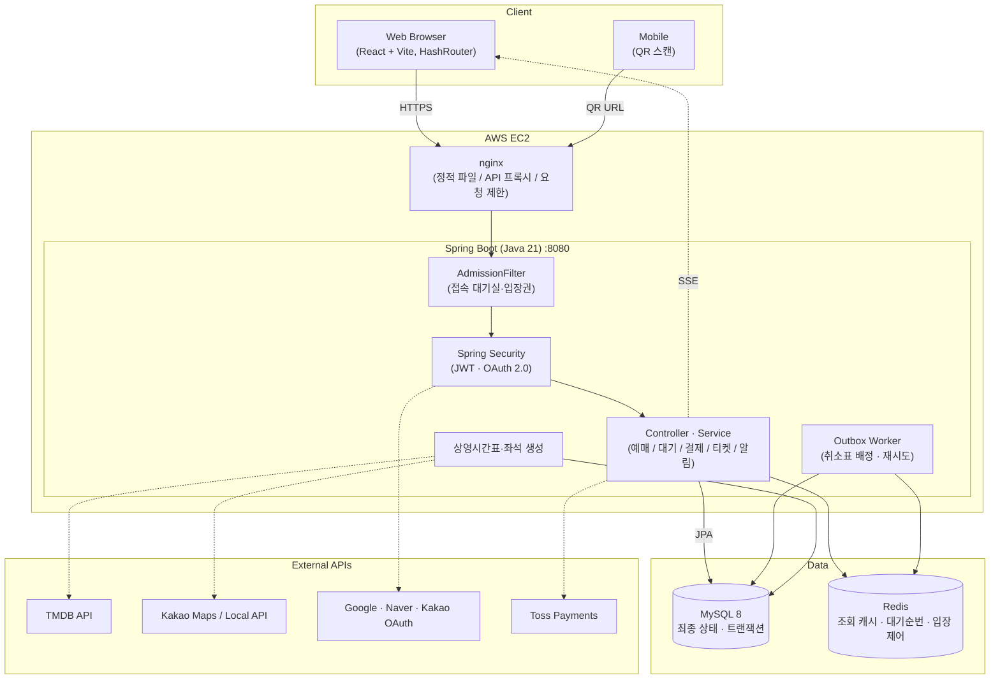
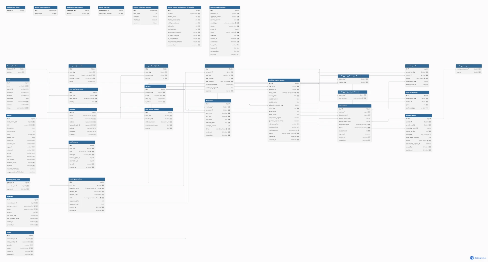

# SmartTicketing

> 선호 정보 기반 영화 스마트 예매 서비스 — 선호 영화관과 좌석 구역 순위를 한 번 저장하면, 조건에 맞는 좌석을 자동으로 찾아 선점하고 매진된 회차는 취소표가 나올 때 자동으로 연결합니다.


배포 주소 : https://smartticketing.duckdns.org

## 최근 개선 사항

- 예매 잠금 범위를 **회차 단위 → 회차·구역 단위**로 줄이고, 확보할 좌석만 잠근 뒤 다시 확인
- 취소표 배정을 **Outbox 이벤트**로 처리해 취소와 배정이 어긋나지 않도록 하고, 실패 시 재시도·복구
- 대기순번 조회를 매번 DB `COUNT` 대신 **Redis 정렬 집합(`ZCOUNT`)** 으로 계산, 버전이 맞지 않으면 DB로 대신 조회
- 메인·시간표·좌석 배치도 조회에 **Redis 캐시** 적용 (설정으로 ON/OFF)
- 사용자가 몰릴 때를 대비한 **사이트 접속 대기실**(Redis 대기열, 입장권) 추가
- **토스페이먼츠 결제**(테스트 키) 추가, 모의결제와 함께 사용
- 가까운 극장 조회를 **MySQL 공간 인덱스**로 변경
- QR 접속·새로고침 시 404가 나지 않도록 **해시 라우팅** 적용
- 회원 탈퇴 후 남아 있던 토큰도 인증 단계에서 차단

## 프로젝트 소개

영화 예매는 매번 극장·시간·좌석을 처음부터 고르고, 좋은 좌석은 경쟁이 심하고, 매진되면 취소표를 계속 새로고침해야 하는 불편이 있습니다.

SmartTicketing은 **선호는 한 번 저장하고, 예매는 서비스가 자동으로** 해 주는 것을 목표로 만들었습니다.

- 선호 영화관 3~5곳과 좌석 구역 6개의 순위를 저장
- 스마트예매는 날짜·시간대·인원만 입력하면 선호 순위에 맞는 좌석 후보를 찾아 **5분 동안 선점**
- 원하는 구역이 없으면 다른 구역 좌석을 추천하면서 **선호 구역 대기번호**를 발급하고, 취소표가 나오면 자동 선점 후 실시간 알림
- 같은 좌석에 동시에 요청해도 **한 명만 선점**, 중복 예매 방지

개발은 **MySQL로 예매 시스템을 먼저 구현 → Redis로 성능 개선 → k6로 전후 비교** 순서로 진행했습니다.

## 주요 기능

### 회원 및 인증

| 기능 | 설명 |
| --- | --- |
| 회원가입 / 로그인 | 이름, 아이디(이메일 형식, 중복 확인), 비밀번호(8~100자), 생년월일 / JWT 발급 |
| 소셜 간편가입 | 구글·네이버·카카오 OAuth 2.0, 이름·이메일 자동 입력 (카카오는 이름만) |
| 계정 찾기 | 이름으로 아이디 목록 조회, 이름·아이디 확인 후 비밀번호 재설정 |
| 비밀번호 보안 | BCrypt 해시 저장 |
| 회원정보 / 탈퇴 | 거주지·선호 영화관·선호 좌석 수정, 탈퇴 시 `WITHDRAWN` 처리 후 기존 토큰도 차단 |

### 선호 설정

| 기능 | 설명 |
| --- | --- |
| 거주지 선택 | 현재 위치, 지도 선택, 주소 검색 (카카오맵) |
| 선호 영화관 | 거리 기준 가까운 영화관 12곳 중 3~5곳을 순위대로 선택 |
| 선호 좌석 | 사이드·중앙 × 앞·중간·뒤 6개 구역의 순위를 모두 지정 |

### 영화·극장 데이터

| 기능 | 설명 |
| --- | --- |
| 영화 수집 | TMDB API로 포스터, 예고편, 출연진, 등급, 개봉일 수집, 개봉일 기준 상영작·상영예정작 분류 |
| 극장 수집 | 카카오 로컬 API로 서울 CGV·롯데시네마·메가박스 지점과 좌표 수집 |
| 상영관·좌석 | 극장당 10관, 관마다 120석(6개 좌석 구역) 자동 생성 |
| 상영시간표 | 누적 관객 상위 10편을 순위별로 배분해 **3일치 자동 편성** (첫 회차 08:00, 03:00 전 종료, 광고 10분 + 청소 20분) |
| 회차별 좌석 | 회차마다 좌석 재고(`showtime_seats`) 생성, 이미 있는 날짜는 건너뛰어 재실행해도 안전 |

### 예매

| 기능 | 설명 |
| --- | --- |
| 스마트예매 | 영화·날짜·시간대·인원 입력 → 선호 순위로 후보 탐색 → 5분 선점 |
| 일반예매 | 극장(선호극장·지점 목록·지도) → 회차 → 좌석 배치도에서 직접 선택 (최대 6석, 연속 좌석 안내) |
| 선점 / 만료 | 5분 안에 결제하지 않으면 자동 만료 후 좌석 반환 |
| 동시성 제어 | 회차·구역 단위 잠금, 같은 좌석은 한 명만 선점 |
| 중복 요청 방지 | `Idempotency-Key`로 같은 요청을 한 번만 처리 |
| 진행 중 예매 복구 | 화면을 벗어나도 선점·대기 중인 예매로 다시 진행 |

### 스마트예매 후보 전략

| 후보 | 우선 기준 |
| --- | --- |
| 선호 좌석 | 선호 구역 순위 |
| 균형 추천 | 좌석 선호와 앞선 대기를 함께 고려 |
| 빠른 예매 | 즉시 선점 가능 여부 |

- 구역 안에서는 관람 인원에 맞는 **연석**을 우선합니다.
- 처음으로 예매 가능한 후보를 선점하고, 그보다 앞선 후보는 **대기로 유지**합니다.
- 모든 후보가 즉시 예매 불가하면 모두 대기로 등록합니다.

### 취소표 대기

| 기능 | 설명 |
| --- | --- |
| 대기 신청 | 회차·좌석 구역별 대기번호 발급, 내 앞 대기 인원 표시 |
| 자동 배정 | 취소·만료로 좌석이 생기면 같은 구역 대기 1순번에게 배정하고 5분 선점 |
| Outbox 처리 | 취소와 같은 트랜잭션에 이벤트를 기록하고 워커가 처리, 실패 시 재시도·복구 |

### 결제·티켓·알림

| 기능 | 설명 |
| --- | --- |
| 결제 | 모의결제, 토스페이먼츠 결제(테스트 키) |
| QR 티켓 | 결제 완료 후 발급, 내 티켓·상단 메뉴에서 조회 |
| 입장 확인 | 휴대폰으로 QR 스캔 → 확인 페이지에서 사용 처리(`USED`) |
| 실시간 알림 | SSE로 선점 시작, 순번 도착, 예매 완료·취소, 결제 실패, 선점 만료 알림 |

## 서비스 구조



## ERD



테이블 31개, Enum 19개, 7개 영역으로 구성됩니다.

### ERD 테이블 설명

| 영역 | 핵심 테이블 | 역할 |
| --- | --- | --- |
| 회원 | `users`, `user_social_accounts`, `user_preferred_seats`, `user_preferred_theaters`, `user_nearby_theaters` | 회원 정보, 소셜 계정, 선호 좌석 6순위·선호 영화관, 주변 극장 이동시간 |
| 영화·극장·상영 | `movies`, `theaters`, `theater_locations`, `screens`, `seats`, `showtimes`, `showtime_seats` | 영화 → 극장 → 상영관 → 좌석, 회차별 좌석 상태(빈 좌석·선점·예매) |
| 예매 | `booking_request_groups`, `reservations`, `reservation_seats`, `booking_group_holds` | 예매 요청 조건과 요청 시점의 선호, 예매·예매 좌석, 선점 만료 |
| 취소표 대기 | `waiting_queues`, `waiting_queue_seats`, `waiting_zone_sequences` | 회차·구역별 대기 순번, 희망 좌석 |
| 결제·티켓 | `payments`, `tickets` | 예매 1건당 결제 1건·티켓 1장, 토스 주문·결제 키 |
| 알림 | `notifications` | 사용자별 알림 |
| 운영·보조 | `booking_operations`, `booking_outbox_events`, `booking_outbox_streams`, `queue_counters`, `booking_user_limits` | 중복 요청 방지, Outbox 이벤트, 순번 발급, 사용자 단위 잠금 |

`showtime_seats(showtime_id, seat_id)`는 회차·좌석 조합이 하나만 존재하도록 유일 제약을 두고, 선점할 때 행을 잠가 중복 예매를 막습니다.

## 성능 검증

k6 스파이크 테스트로 동시 사용자 500~8000명을 9단계로 늘리며 측정했습니다. (Redis 적용 전, 로컬)

| 시나리오 | 성능이 꺾이는 지점 | 최대 처리량 (초당) |
| --- | --- | --- |
| 메인·공통 조회 | 3000 → 4000명 | 약 2,600건 |
| 시간표 조회 | 4000 → 5000명 | 약 224건 |
| 좌석 배치도 조회 | 2000 → 3000명 | 약 1,280건 |

- 시간표 조회는 CPU 여유가 있는데 처리량이 멈춰, DB 커넥션 풀 대기를 병목으로 판단하고 Redis 캐시 대상으로 선정
- 10000명에서 성공이 정확히 8,192명 → Tomcat 최대 연결 수 한계로 확인하고 최대 인원을 8000명으로 설정

## 기술 스택

| 구분 | 기술 |
| --- | --- |
| Frontend | React, Vite, React Router (HashRouter) |
| Backend | Java 21, Spring Boot, Spring Security, Spring Data JPA, Gradle |
| Database / Cache | MySQL 8, Redis |
| Auth | JWT, OAuth 2.0 (Google, Naver, Kakao) |
| External API | TMDB, Kakao Maps · Local, Toss Payments |
| Realtime | SSE |
| Infra / CI·CD | AWS EC2, Docker Compose, nginx, GitHub Actions |
| Test | JUnit 5, Vitest, k6 |

## 실행 방법

### 준비

- JDK 21, Node.js, MySQL 8 (`localhost:3306`, DB `smart_ticketing`은 자동 생성)
- Redis : Windows는 WSL Ubuntu 안에서 실행 (`local.cmd`가 설치·실행)
- 프로젝트 루트에 `.env` 파일 (값은 팀 노션에서 공유, **저장소에 올리지 않음**)

| 구분 | 변수 |
| --- | --- |
| DB | `DB_USERNAME`, `DB_PASSWORD` |
| 인증 | `JWT_SECRET`, `JWT_EXPIRATION_SECONDS`, `FRONTEND_URL` |
| 소셜 로그인 | `GOOGLE_CLIENT_ID/SECRET`, `NAVER_CLIENT_ID/SECRET`, `KAKAO_CLIENT_ID/SECRET` |
| 지도 | `VITE_KAKAO_MAP_JS_KEY`, `KAKAO_MAP_REST_API_KEY` |
| 영화 데이터 | `TMDB_ACCESS_TOKEN` |
| 결제 | `VITE_TOSS_CLIENT_KEY`, `TOSS_SECRET_KEY` |
| 관리자 | `ADMIN_KEY`, `ADMIN_INITIAL_PASSWORD` |
| 기타 | `SPRING_PROFILES_ACTIVE`, `ADMISSION_ENABLED`, `VITE_API_BASE_URL` |

### 로컬 실행

```powershell
# 1. Redis 설치 (처음 한 번, WSL Ubuntu 필요)
.\local.cmd setup

# 2. Redis 실행 (재부팅 후마다)
.\local.cmd redis-start

# 3. 백엔드 실행 (캐시 ON / OFF 선택 가능)
.\local.cmd on

# 4. 프론트엔드 실행
cd frontend
npm install
npm run dev
```

실행 후 `http://localhost:5173`으로 접속합니다. 서버가 처음 시작될 때 영화·극장 데이터와 3일치 상영시간표·좌석이 자동으로 준비됩니다.

### 테스트

```powershell
.\gradlew.bat test          # 백엔드 (JUnit)
cd frontend; npm test       # 프론트엔드 (Vitest)
```

### 배포

`main`에 병합되면 GitHub Actions(`Test and deploy SmartTicketing`)가 테스트 후 jar와 Docker 이미지를 만들어 AWS EC2에 배포합니다. 서버에서는 빌드하지 않고 만들어진 jar로 실행만 합니다.

## 프로젝트 구조

```text
src/main/java/smartticketing/
  admission/     사이트 접속 대기실 (Redis 대기열, 입장권)
  auth/          JWT, OAuth 2.0
  config/        보안·Redis·데이터 초기화 설정
  controller/    REST API
  dto/           요청·응답 객체
  entity/        JPA 엔티티, Enum
  repository/    JPA 리포지토리
  service/       예매·대기·결제·티켓·알림·Outbox·상영시간표 생성
frontend/src/
  booking/       스마트예매·일반예매·좌석 선택·대기 화면
  pages/         메인, 로그인, 회원정보, 티켓, 알림 화면
  api/           API 호출 모듈
k6/              부하 테스트 스크립트
deploy/          배포 스크립트, nginx 설정, 점검 스크립트
docs/            기능별 설계 문서 (접속 대기실, 공간 검색, 조회 최적화, 토스 결제)
local.cmd        로컬 Redis 설치·실행, 캐시 모드 전환
```

## 팀원 소개

| 이름 | 역할 | GitHub |
| --- | --- | --- |
| 안정현 | 팀장 / 좌석·예매 + 모의결제·취소표 대기 | [ahnjh97](https://github.com/ahnjh97) |
| 주상혁 | 회원·인증 + 알림·티켓 | [jusanghyeok](https://github.com/jusanghyeok) |
| 이연화 | 영화·극장 + 추천·데이터 | [dusghk0802](https://github.com/dusghk0802) |

### 안정현 · 팀장 / 좌석·예매

- 예매 흐름, 스마트예매 후보 탐색과 좌석 자동 선점
- 회차·구역 단위 잠금으로 동시성 제어
- 모의결제·토스 결제, 취소·만료, 취소표 순번 처리와 Outbox 기반 배정
- 사이트 접속 대기실, Redis 대기순번 조회 개선

### 주상혁 · 회원·인증 / 알림·티켓

- 일반·소셜 회원가입과 로그인, 계정 연동, 회원정보 관리
- SSE 실시간 알림
- QR 티켓 발급과 입장 확인, 해시 라우팅
- AWS 배포와 CI/CD 구성

### 이연화 · 영화·극장 / 데이터

- 메인 화면, 영화 수집(TMDB)과 영화 상세
- 극장 정보 수집(카카오), 상영관·좌석, 3일치 상영시간표 자동 생성
- ERD 설계, k6 부하 테스트(Redis 적용 전 측정)

## 한 줄 회고

> 팀원별 한 줄 회고를 작성해 주세요.

- **안정현** : “”
- **주상혁** : “”
- **이연화** : “”

## 보안 주의

`.env`, API 키(TMDB, 카카오, 네이버, 토스), OAuth 비밀값, JWT 비밀키, DB·관리자 비밀번호, 로그, 부하 테스트 결과 파일은 Git에 올리지 않습니다. 토스 결제는 테스트 키만 사용합니다.
