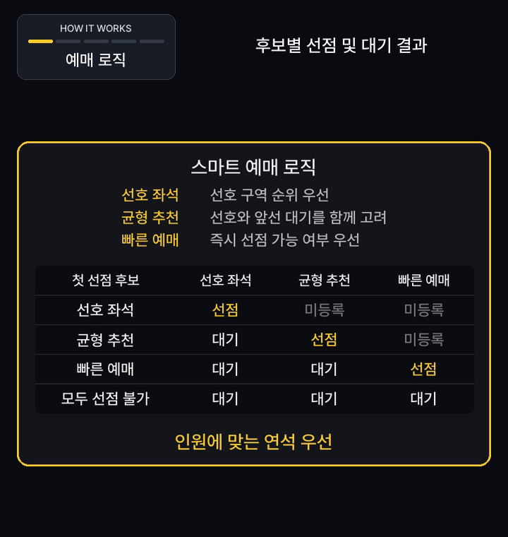
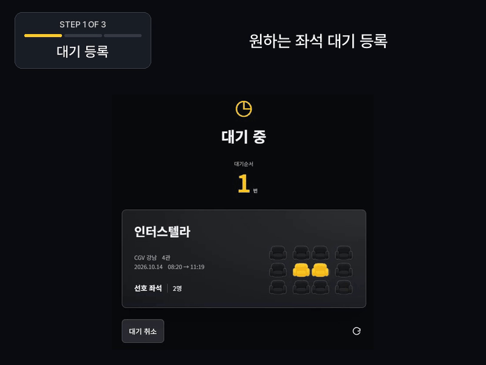
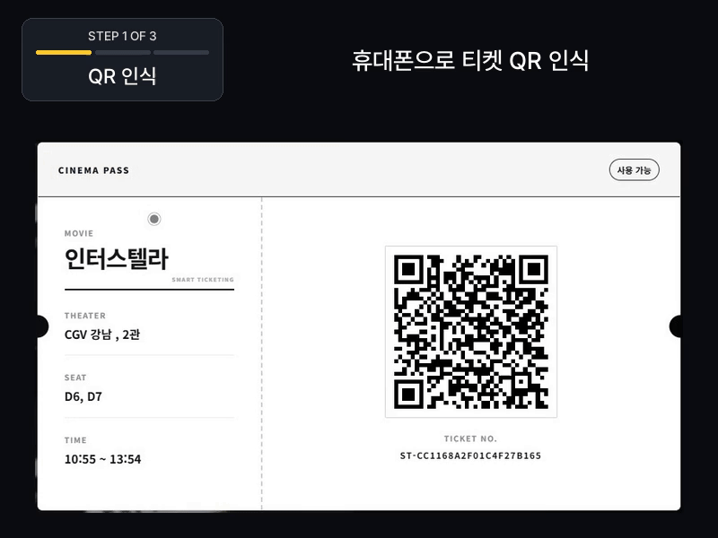
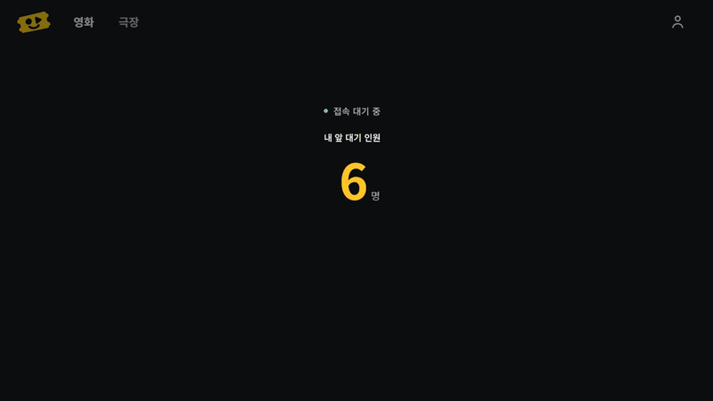
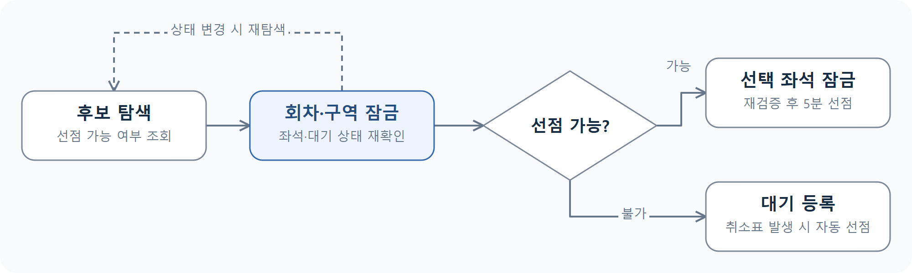
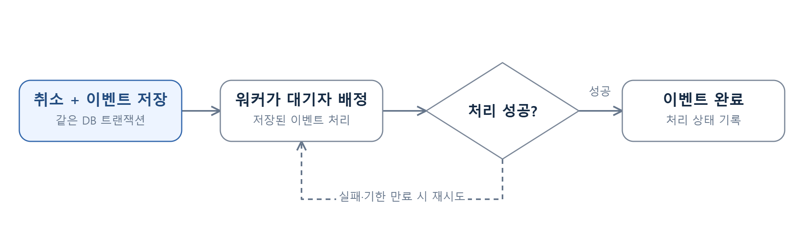
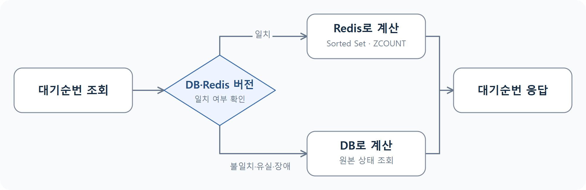
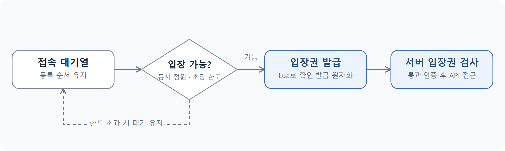

# SmartTicketing

**선호 영화관·좌석 기반 스마트예매와 취소표 자동 선점 서비스**

▶️ [**시연 영상**](https://youtu.be/H-EKAsGkqwE) &nbsp;&nbsp;|&nbsp;&nbsp; 🌐 [**접속 링크**](https://smartticketing.duckdns.org)

[프로젝트 소개](#overview) &nbsp;&nbsp;|&nbsp;&nbsp; [기술 스택](#stack) &nbsp;&nbsp;|&nbsp;&nbsp; [주요 구현](#features) &nbsp;&nbsp;|&nbsp;&nbsp; [문제 해결](#troubleshooting)

 

## 📌 프로젝트 소개

선호 영화관과 좌석 구역을 저장하고, 날짜·시간대·인원을 선택하면 조건에 맞는 좌석을 자동 탐색합니다. 예매 가능한 좌석은 **5분간 선점**하고, 원하는 좌석이 없으면 **대기 등록 후 취소표 발생 시 자동 선점**합니다.

📅 **개발 기간** : 2026.09.28 ~ 2026.10.12 
👥 **개발 인원** : 3인 
🙋 **담당 역할** : 팀장 / 스마트·일반예매, 취소표·접속 대기열, 동시성 제어 및 성능 개선

 

## 🛠️ 기술 스택

| 구분 | 기술 | 활용 |
| :--- | :--- | :--- |
| **Backend** | `Java 21` `Spring Boot 4` `Spring Data JPA` | 예매 로직, 트랜잭션, 좌석 잠금 |
| **Database / Cache** | `MySQL 8` `Redis` `Lua` | 재고 관리, 조회 캐시, 대기열 |
| **Frontend** | `React` `Vite` | 예매·좌석 선택·대기 화면 |
| **Auth / Realtime** | `Spring Security` `JWT` `OAuth 2.0` `SSE` | 인증, 소셜 로그인, 실시간 알림 |
| **Infra / CI·CD** | `AWS EC2` `Docker Compose` `Nginx` `GitHub Actions` | 배포, 프록시, 빌드·테스트 자동화 |
| **Test** | `JUnit 5` `Vitest` `k6` | 동시성·복구 테스트, 부하 비교 |

 

## ✨ 주요 구현

| 기능 | 구현 내용 |
| :--- | :--- |
| **스마트예매** | 선호 순위에 따른 후보 탐색, 연석 우선 자동 선점 |
| **일반예매** | 회차·좌석 직접 선택, 스마트예매와 공통 재고 사용 |
| **취소표 대기** | 회차·구역별 대기 등록, 취소·만료 시 자동 선점 및 알림 |
| **예매 상태 관리** | 5분 선점, 모의결제·취소·만료 처리, 중복 요청 방지 및 예매 복구 |
| **접속 대기열** | Redis 기반 순차 입장, 동시 입장 정원·초당 입장 한도 제어, 서버 입장권 검증 |

<strong>⚖️ 스마트 예매 결과 비교 (GIF)</strong>

<strong>🔔 취소표 자동 선점 (GIF)</strong>

<strong>🎫 QR 티켓 사용 (GIF)</strong>

<strong>⏳ 접속 대기열 (GIF)</strong>

 

## 💡 문제 해결

### 1. 구역 단위 잠금으로 좌석 선점 경합 완화

**문제**

- 중복 선점 방지를 위해 회차와 전체 좌석을 잠금.
- 서로 다른 구역의 요청까지 대기하고, 상태 조회에서도 쓰기 잠금·만료 처리가 발생.

**해결**

- 잠금 범위를 **회차 전체 → 회차·구역과 선택 좌석**으로 축소.
- 선점 가능 여부를 먼저 조회하고, 구역 잠금 후 좌석·대기 상태를 재확인. 변경 시 재탐색하고, 선점할 좌석만 잠금·재검증.
- 선점·결제·취소·만료에 동일한 잠금 규칙 적용.
- 상태 조회는 읽기 전용으로 분리하고, 실제 좌석 반환은 워커와 변경 요청에서 처리.

**결과**

- 전체 좌석 잠금을 제거해 다른 구역의 요청 간 경합 범위 축소. 잔여석·Outbox 버전 갱신 구간의 회차 잠금만 유지.
- 상태 조회에서 쓰기 잠금과 만료 처리를 제거해 조회·선점 요청 간 간섭 완화.

---

### 2. Transactional Outbox로 취소표 배정 이벤트 유실 방지

**문제**

- 취소와 배정을 한 요청에서 처리하면 트랜잭션과 잠금 유지 시간이 증가.
- 후속 작업을 메모리에서만 관리하면 서버 중단 시 배정 누락 가능.

**해결**

- 좌석 상태 변경과 **Outbox 이벤트를 같은 트랜잭션에 저장**.
- 워커가 이벤트를 읽어 배정하고, 실패하거나 처리 기한이 지나면 재시도.
- 같은 회차의 작업은 묶어서 처리하고, 이전 워커의 뒤늦은 완료 처리는 토큰으로 차단.

**결과**

- 서버 재시작 후에도 저장된 미완료 이벤트를 다시 처리해 취소표 배정 재개.
- 이벤트 재처리 시 중복 배정을 방지하고, 취소 요청에서 후속 배정 작업 분리.

---

### 3. 대기순번 캐시의 오래된 데이터 반환 방지

**문제**

- 순번 조회마다 DB에서 앞선 대기자를 계산해 조회 비용 누적.
- Redis만 조회하면 취소·구역 변경·이벤트 지연 시 오래된 순번을 반환할 가능성.

**해결**

- **DB·Redis 버전이 일치할 때만** Sorted Set의 `ZCOUNT`로 순번 계산.
- 버전 불일치·키 유실·Redis 장애 시 DB 조회로 전환.
- Outbox와 Lua로 변경분·버전을 함께 갱신하고, 복구에 필요한 이력이 없으면 DB 기준으로 재구축.

**결과**

- 유효한 캐시가 있으면 DB의 대기순번 집계 쿼리를 생략해 반복 조회 비용 절감.
- 캐시 반영 지연·유실·Redis 장애에도 DB 기준으로 순번을 응답하고, 오래된 이벤트가 최신 캐시를 덮어쓰는 문제 방지.

---

### 4. Redis 기반 입장 제어로 API 유입량 제한

**문제**

- 조회를 최적화해도 동시 접속이 늘면 업무 API로 요청 집중.
- 대기 화면만 표시하면 직접 API를 호출해 대기열 우회 가능.

**해결**

- Redis 대기열과 **동시 입장 정원·초당 입장 한도** 적용.
- Lua로 정원 확인과 입장권 발급을 원자적으로 처리.
- 서버 필터에서 입장권을 검사하고, 입장 전에는 프런트엔드의 업무 조회도 시작하지 않도록 제한.

**결과**

- 설정한 정원·초당 입장 한도 내에서 사용자를 입장시키고, 초과 접속자는 대기열에서 대기.
- 입장권 없는 직접 API 요청을 차단하고, 입장 제어용 Redis 장애 시 `503`을 반환해 무제한 입장 방지.
